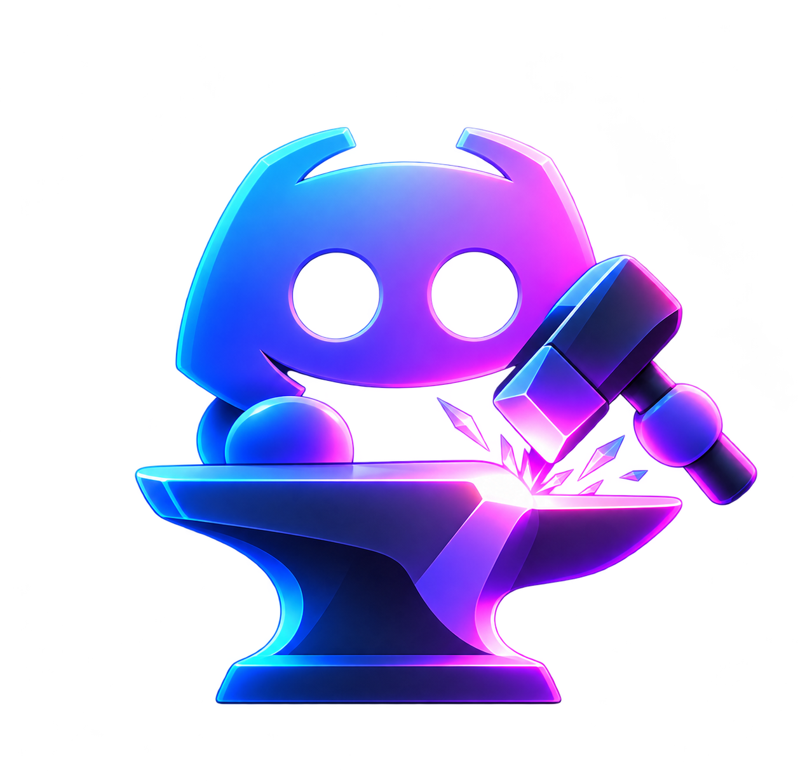

<p align="center">
  
</p>

<p align="center">
  
</p>

<h1 align="center">DiscoForge</h1>

<p align="center">
  <b>Forge your Discord server into a fully working project-management workstation.</b><br>
  Task boards, assignees, priorities, due dates and a credentials vault, all inside the channels you already use.
</p>

<p align="center">
  
  
  
</p>

---

## ✨ What it does

- **📋 Task boards in plain chat.** Type `- Fix user dashboard authentication` in a category channel. The bot swaps it for a clean task card. Mention `#other-category` channels (subcategories) and `@users` (assignees) in the same message to file and assign it right away.
- **🎛️ Reaction controls.** ⏳ doing · ✅ done · ❌ discarded · 🐛 bug · 📌 important (auto-pinned) · 📝 edit the task text · 👁️ show/hide details · ⚙️ settings panel · 🗑️ delete.
- **👥 Many assignees, many categories.** Set priority (🔴🟠🟡🟢), due dates (extendable any time), one or more assignees and one or more categories. The task is mirrored into every related channel and all copies stay in sync.
- **📊 `/category_info`.** Open tasks, priorities, bugs, imminent deadlines and per-user load, shown as jump links to the task messages.
- **🔑 Credentials vault.** Paste messy logins or API keys. The bot reposts them in a clean format. Regex-based, no AI API needed.
- **📎 Images and files** sent with a task are embedded in it. No external hosting or extra API key.

## 🚀 Quick start

1. Create an app at the [Discord Developer Portal](https://discord.com/developers/applications). In the **Bot** tab copy the **token** and enable **Message Content Intent**.
2. Clone, install and configure:
   ```bash
   git clone <your-repo-url> discoforge && cd discoforge
   npm install
   cp .env.example .env   # fill DISCORD_TOKEN and CLIENT_ID (GUILD_ID optional, for instant commands)
   ```
3. Invite the bot (replace `YOUR_CLIENT_ID`):
   ```
   https://discord.com/oauth2/authorize?client_id=YOUR_CLIENT_ID&scope=bot%20applications.commands&permissions=126016
   ```
4. Register the commands and start:
   ```bash
   npm run deploy
   npm start
   ```

Permissions requested: View Channels, Send Messages, Manage Messages, Embed Links, Attach Files, Read Message History, Add Reactions.

## 🧭 Setup in your server

| Command | What it does |
|---|---|
| `/set_category [name]` | This channel becomes a task category (dashboard, payments…) |
| `/set_assignee user` | This channel becomes a user's personal task list |
| `/credentials_channel` | This channel becomes the credentials vault |
| `/unset_channel` | Remove the marking (existing tasks are kept) |
| `/category_info [channel]` | Navigable stats and links (only you see it) |
| `/help` | Paged guide (only you see it) |

Setup commands need the **Manage Channels** permission. Task and credentials channels are dedicated: any other message gets a polite reminder.

## 🔑 Credentials format

```
https://m365.cloud.microsoft/
user@mail.com
myPassw0rd
```

or a named list of keys

```
OpenAI
123504-b6d4...  Access Token
AI-123504-9b3f...  AI KEY
```

or a server login (IP, password, optional username)

```
windows server per compilare
159.159.16.200
myPassw0rd
```

The named list becomes

> ### Credentials OpenAI
>
> **Api Key - Access Token:** 123504-b6d4...
> **Api Key - AI KEY:** AI-123504-9b3f...

and the server login becomes

> ### Credentials 159.159.16.200 server
> **IP:** 159.159.16.200
> **Username:** Administrator
> **Password:** myPassw0rd

A login needs a website plus email/username and password, or an API key. A server needs an IP plus a password, and the username defaults to `Administrator`. Incomplete messages are rejected with a hint.

## ✏️ Task reactions

| Reaction | Action |
|---|---|
| ⏳ / ✅ / ❌ | Doing / done / discarded (purple / green / grey) |
| 🐛 | Toggle bug flag |
| 📌 | Toggle important (gold card, pinned) |
| 📝 | Edit the task text (opens an *Edit text* button and a pop-up) |
| 👁️ | Show/hide status, priority, due date, categories and assignees |
| ⚙️ | Settings panel: priority, due date, assignees, subcategories |
| 🗑️ | Delete the task everywhere |

## ⚙️ Configuration

**Task style** (`TASK_FORMAT` in `.env`):

- `webhook` (default): a rich embed card with colours, header tags and a footer.
- `plain`: a lightweight text message. Same reactions and pop-ups. Mentions never ping.

| State | Plain message |
|---|---|
| doing | `- @whosifrago analizzalo, vedi se ti trovi con questo report` |
| done / discarded | `✅ @whosifrago analizzalo…` / `❌ @whosifrago analizzalo…` |
| bug / important | an extra first line: `**[BUG] 🐛 **` / `**[IMPORTANT] ⚠️ **` |
| 👁️ details | a `[Data]` and `[Details]` block (status, priority, due date, category, assignees, **Assigned by:** as a plain name, no tag) appended below |

Discord limits plain messages to 2000 characters, so longer text is cut when displayed. After changing `TASK_FORMAT` and restarting, existing tasks switch format the next time they are updated.

See [`.env.example`](.env.example). Data lives in a single SQLite file (`DB_PATH`, default `./data/discoforge.db`). Back it up if you care about your tasks.

## 🧪 Tests

```bash
npm test
```

## Notes

- Tasks are bot-sent embeds, not real webhooks: that is what makes reactions, pins and edits work.
- An attachment larger than the server's upload limit makes task creation fail, and your original message is left untouched.
- Discord allows 50 pins per channel.
